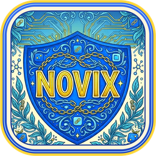

<p align="center">
  
</p>

<h1 align="center">Novix</h1>

<p align="center">
  Seus mensageiros e sistemas web numa barra lateral, num app só.<br>
  WhatsApp, Teams, Telegram, Slack, Gmail, Outlook ou qualquer endereço da web.
</p>

<p align="center">
  <a href="https://github.com/joao-eder/Novix-releases/releases/latest"><b>Baixar a versão mais recente</b></a>
</p>

---

## O que ele faz

- **Tudo numa janela**: cada serviço vira um ícone na barra lateral. Um clique troca de app, sem abas perdidas no navegador.
- **Qualquer site**: cole o endereço e o Novix busca o nome e o ícone sozinho. Funciona com sistemas internos, endereços de IP e certificados próprios.
- **Contas separadas**: cada app tem a sua sessão. Dá para ter dois WhatsApp ou dois Teams ao mesmo tempo.
- **Notificações e contadores**: avisos do sistema e o número de mensagens não lidas em cada app, na bandeja e na barra de tarefas.
- **Controle por app**: ative, silencie ou desligue as notificações de cada um com o botão direito.
- **Não perturbe**: silencia todos os apps de uma vez.
- **Tema claro e escuro**, zoom por app e atalhos de teclado.
- **Atualiza sozinho**: quando sai uma versão nova, aparece um botão no app. Ele baixa, instala e abre de novo, sem perder seus apps e logins.

## Download

Na página da [versão mais recente](https://github.com/joao-eder/Novix-releases/releases/latest), em **Assets**:

| Sistema | Arquivo |
| --- | --- |
| Windows 10 e 11 (64 bits) | `Novix-<versão>-windows-x64.msi` |
| macOS 12 ou mais novo, Apple Silicon (M1, M2, M3…) | `Novix-<versão>-mac-arm64.dmg` |
| macOS 12 ou mais novo, Intel | `Novix-<versão>-mac-x64.dmg` |
| Linux (Flatpak) | `Novix-<versão>-linux-x86_64.flatpak` |

### Instalação

**Windows**: abra o `.msi`. Se aparecer "O Windows protegeu o computador", clique em **Mais informações** e depois em **Executar assim mesmo**.

**macOS**: abra o `.dmg` e arraste o Novix para **Aplicativos**. Na primeira vez, abra com **clique direito > Abrir**. Se o macOS disser que o app "está danificado", rode no Terminal:

```
xattr -cr /Applications/Novix.app
```

**Linux**: com o Flatpak instalado, rode:

```
flatpak install --user Novix-<versão>-linux-x86_64.flatpak
```

Esses avisos aparecem porque o Novix ainda não tem certificado de desenvolvedor da Microsoft e da Apple. O app não muda nada no sistema além da própria pasta.

## Atualizações

O Novix procura versões novas ao abrir e a cada 6 horas. Quando há uma, aparece um botão na barra lateral, acima da engrenagem. Também dá para procurar na hora em **Configurações > Geral > Atualizações**.

- **Windows e macOS**: o próprio app baixa, instala e abre de novo.
- **Linux**: o botão abre esta página para baixar o arquivo novo.

Seus apps, logins e configurações ficam guardados no seu usuário e continuam lá depois de atualizar.

## Privacidade

O Novix não coleta dados nem tem servidor próprio. Cada app conversa direto com o serviço dele (WhatsApp, Teams…), como no navegador. A única coisa que o Novix consulta por conta própria é esta página, para saber se há versão nova.
